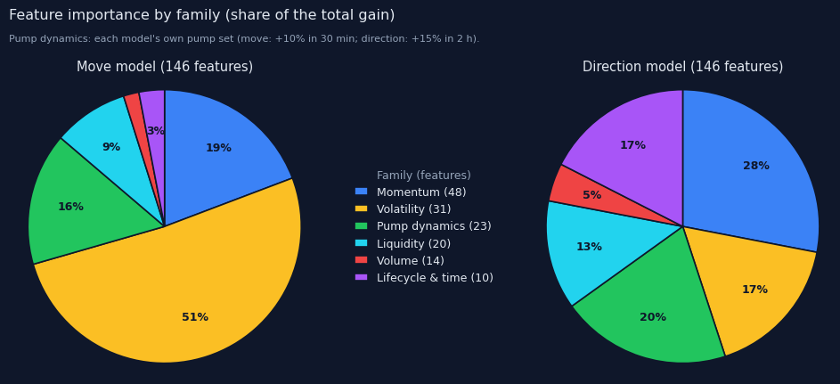
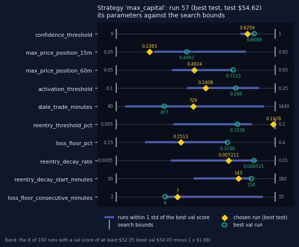
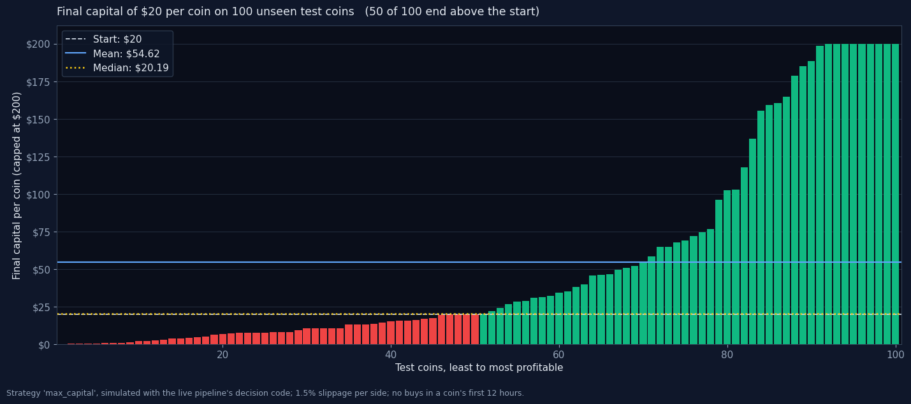
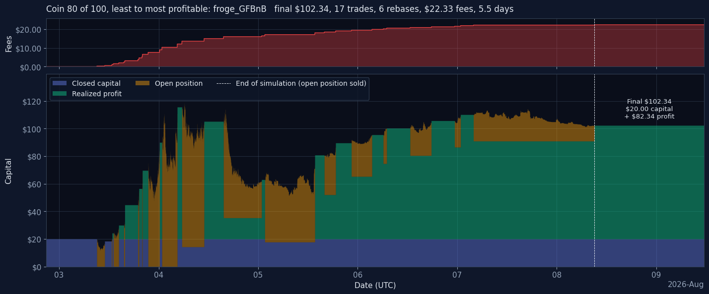

# Solana meme-coin trading bot

## Contents

1. [Introduction](#1-introduction)
2. [Repository layout](#2-repository-layout)
3. [Terminology](#3-terminology)
4. [Development and research notebooks](#4-development-and-research-notebooks)
5. [Results of the model search and the strategy optimisation](#5-results-of-the-model-search-and-the-strategy-optimisation)
6. [From the notebooks to the bot](#6-from-the-notebooks-to-the-bot)
7. [The trading strategy](#7-the-trading-strategy)
8. [Is the trading strategy profitable?](#8-is-the-trading-strategy-profitable)
9. [Installation](#9-installation)
10. [Usage](#10-usage)
11. [Dashboard](#11-dashboard)
12. [Live pipeline](#12-live-pipeline)

---

## 1. Introduction

This project is an end-to-end machine-learning pipeline for Solana-based meme coins. It collects live, minute-by-minute OHLCV candles from GeckoTerminal's free API, appends the new minutes to an existing database, cleans the data and builds a set of 169 features for two gradient-boosted XGBoost models. The first model predicts an imminent move; the second predicts the direction of that move. Together they power a trading strategy, which is tuned with Optuna on separate tuning, validation and test sets of coins. Up to 10 bots, each running in its own Python process, use the tuned strategy and the two models to paper trade selected meme coins behind a Flask web dashboard. The entire live pipeline is built to run on a local Linux server, in my case a Raspberry Pi 5.

The repository has three main parts:

* **Development notebooks:** the five-step pipeline from raw candles to the two models and the tuned strategy. The Python files of the live pipeline were developed from these notebooks.
* **Research notebooks:** notebooks whose sole purpose was to research relevant questions and to create the visuals in this README.
* **Live pipeline:** the multi-bot application, with a Python back end, an SQLite database and a single-page dashboard, which runs on a Raspberry Pi 5.

The file [`development_log.md`](development_log.md) was kept throughout development. It records every relevant experiment, its result and the decision taken, from the first label search to the current pipeline. Its §0 is the project guide.

---

## 2. Repository layout

```
├── README.md
├── development_log.md
├── .gitignore
├── development_notebooks/         the pipeline, run in this order
│   ├── meme_coin_pipeline.ipynb
│   ├── data_cleaning.ipynb
│   ├── Dataset_creationV9.ipynb
│   ├── model_search.ipynb
│   └── strategy.ipynb
├── research_notebooks/            studies outside the pipeline
│   ├── readme_visuals/            the README's images
│   ├── finalization_study.ipynb
│   └── profitability_visuals.ipynb
├── live_pipeline/                 the trading application
│   ├── app.py
│   ├── bot_manager.py
│   ├── bot_loop.py
│   ├── data_collection.py
│   ├── features.py
│   ├── scoring.py
│   ├── strategy.py
│   ├── execution.py
│   ├── dex.py
│   ├── database.py
│   ├── templates/                 the dashboard page
│   │   └── dashboard.html
│   └── artifacts/                 the chosen models and strategy files
├── data/                          the data (not committed)
│   ├── raw_data/
│   ├── processed_data/
│   └── dataset_v9/
└── research_development/          the notebooks' outputs (not committed)
    ├── model_search/
    ├── strategy_results/
    ├── finalization_data/
    └── readme_visuals/
```

---

## 3. Terminology

This project uses some domain-specific terms.

* **Solana (SOL):** a fast, low-fee blockchain that hosts most meme-coin trading. Its very low trading fees make it well suited to meme coins, and every coin in this project is traded against SOL.
* **Meme coin:** a highly speculative token whose price is driven by attention and short-term trading rather than by fundamentals. Meme coins are extremely volatile and often short-lived. These are the coins this application trades.
* **Candle / OHLCV:** one minute of trading. A candle holds the first price of the minute (open), the highest price reached within the minute (high), the lowest price (low) and the price when the minute ended (close). The volume is the amount traded within the minute; in this project it is expressed in SOL rather than in the meme coin itself.
* **Move / pump:** a rise of at least 10% within the next 30 minutes. The move model estimates its probability.
* **Direction:** whether the price first reaches +15% or −15% within the next 2 hours. The direction model estimates the probability that +15% comes first.
* **Score / percentile:** in the research, a model output converted to its rank among the model's predictions on the tune split (0 = lowest, 1 = highest). All strategy thresholds are set on these percentiles, so they mean the same for any model. The live bot uses the equivalent raw cutoff (see [6.3](#63-the-models-and-scores)), so it needs no tune predictions.
* **Candidate minute:** a minute that passes the entry gate (the combo score and the price-position filters). Buys and rebases only happen on candidate minutes.
* **Rebase / race:** the loss floor and the stale time never sell. Instead, they start a *race*: the position stays open and is re-anchored (rebased) at the next acceptable candidate minute, unless the take-profit comes first.
* **Paper / shadow / live:** the same decisions with different fills. *Paper* simulates the fills with a fixed fee. *Shadow* asks Jupiter for a real swap quote at the moment of the decision and records that fill, without signing or sending anything. Live trading (real swaps) is not implemented yet, and shadow mode is not fully finished.

---

## 4. Development and research notebooks

### 4.1 Development notebooks

The notebooks that produced the dataset, the models and the strategy parameters. Every notebook is resumable: finished work is skipped when it runs again.

| # | Notebook | Reads | Writes | What it does |
|---|---|---|---|---|
| 1 | [`meme_coin_pipeline`](development_notebooks/meme_coin_pipeline.ipynb) | GeckoTerminal API, `COIN_LIST` | `data/raw_data/` | Collects the 1-minute OHLCV of every pool and applies the fill rule. It stops collecting a coin at its death point (a 48-hour window with less than 1,000 SOL of volume, after a 48-hour grace period) and marks the coin dead. |
| 2 | [`data_cleaning`](development_notebooks/data_cleaning.ipynb) | `data/raw_data/` (never modified) | `data/processed_data/` | Applies the fill rule again, marks each coin's death by volume and by pump rate, and cuts the coin at the earlier of the two. Coins with less than 12 hours of data are left out. |
| 3 | [`Dataset_creationV9`](development_notebooks/Dataset_creationV9.ipynb) | `data/processed_data/` | `data/dataset_v9/` | Computes the 169 causal features and the labels for every minute, runs a leakage test on all features, and splits the coins into 5 stratified sets. |
| 4 | [`model_search`](development_notebooks/model_search.ipynb) | `data/dataset_v9/splits/`, `data/processed_data/` | `research_development/model_search/` | Optuna searches for the move and the direction model (validation metric minus a model-size penalty). The top 10 of each are then judged in trading simulations, which pick the pair (see [5.1](#51-model-search)). |
| 5 | [`strategy`](development_notebooks/strategy.ipynb) | `live_pipeline/artifacts/` (the chosen pair), `data/dataset_v9/splits/`, `data/processed_data/` | `research_development/strategy_results/` | Runs `N_RUNS` strategy optimisations: each is optimised on tune, its parameters are selected on val_tune, and it is then evaluated once on test. The run with the best `SELECT_BY` score (test) is exported as a named strategy file (see [5.2](#52-trading-strategy-optimisation)). |

### 4.2 Research notebooks

| Notebook | Purpose |
|---|---|
| [`profitability_visuals`](research_notebooks/profitability_visuals.ipynb) | Simulates a strategy file from `live_pipeline/artifacts/` on the test coins with the live pipeline's own decision code and draws the README's charts: the final capital per coin, and the capital of one coin over time. It also retrains the two chosen models to show their feature importance per feature family. It writes to `research_development/readme_visuals/`; the charts used in this README are copied by hand into `research_notebooks/readme_visuals/`, which is committed. |
| [`finalization_study`](research_notebooks/finalization_study.ipynb) | **When is a live candle final?** The dataset's candles were collected long after the fact, but the live bot reads a minute only seconds after it ends. The study reads the just-ended candle at 1.0, 1.5, … 40 s after its close (a sweep of 79 offsets, within GeckoTerminal's rate limit) and compares each read with the value 5 minutes later. It checks the computer's clock against the server's `Date` header on every call, survives restarts and logs every rate-limit hit. A standalone statistics cell reports, per field and for the whole candle, the earliest second at which 95 / 99 / 99.9% of candles are final, per coin and for all coins together. It writes to `research_development/finalization_data/`. |

### 4.3 Folders

Every notebook finds the repository's top folder by itself, so it runs from wherever Jupyter starts. It reads and writes its data in `data/` (`raw_data/`, `processed_data/`, `dataset_v9/`) and its other outputs in `research_development/`, in the output folders it has always used (`model_search/`, `strategy_results/`, `finalization_data/`, `readme_visuals/`). Neither folder is committed. The notebooks that use the chosen models (`strategy` and `profitability_visuals`) read them from `live_pipeline/artifacts/`, together with the strategy files. Everything in that folder is copied there by hand (see [6.1](#61-the-artifacts-folder)).

### 4.4 Data

402 coins, collected by hand-picking pools that met a fixed screen when they were added: Solana, at least $20k of liquidity, a GeckoTerminal security score of at least 50, and between 12 hours and 3 months old. Prices and volume are in SOL. §0.4 of the development log documents where the data comes from and every change made to it.

### 4.5 Splits

The coins are split by coin, stratified by length × move (pump) rate, into 15 / 10 / 25 / 25 / 25%:

| Split | Coins | Used for |
|---|---|---|
| `train` / `val_train` | 59 / 39 | training the models / early stopping |
| `tune` / `val_tune` | 102 / 102 | optimising the strategy / selecting and reporting; the percentile references come from tune |
| `test` | 100 | read once per strategy run, after everything is fixed |

### 4.6 Features

169 features, every window taken from a fixed set between 1 minute and 7 days:

* **Lifecycle and time:** minutes since launch, launch characteristics, hour of the day (UTC).
* **Volatility:** several horizons, its dynamics (change, clustering, trend) and its context (percentile, intraday pattern).
* **Volume:** ratios, z-scores, dispersion, autocorrelation, skewness, concentration, volume × volatility.
* **Momentum:** returns from 1 minute to 3 days, the distance to the all-time high, and price positions within the last 15 minutes to 24 hours.
* **Pump dynamics:** two pump definitions, one per model (+10% within 30 minutes for the move model, +15% within 2 hours for the direction model), with 23 features each: clustering, velocity, density, failure rate and time between pumps.
* **Liquidity:** a causal estimate of the SOL needed for a 1% price impact (`estimated_sol_1pct_impact`), its age and uncertainty, and liquidity trends.

Each model uses **146** of the 169 features: the 123 that both models share, plus its own pump set of 23. The other model's pump set is left out.

### 4.7 Labels

* `label_10pct_30m` for the move model.
* `label_fpclass_15pct_2h` for the direction model: up first, down first, or neither.
* `label_meta_minutes_to_end`: training rows need at least 240 minutes of future. It is never used as a feature.

### 4.8 The models

* The **move** model predicts P(the close rises ≥ 10% within 30 minutes), from 146 features (the shared ones and the +10% / 30 min pump set).
* The **direction** model predicts P(+15% is reached before −15% within 2 hours), from 146 features (the shared ones and the +15% / 2 h pump set). It is trained **only on candidate minutes**: tradable minutes where the move score is in its top 50% and the outcome is decided within 2 hours. This "A50" recipe was the single biggest model-side improvement found (development log §21–22).
* The buy score (**combo**) is the tune percentile of P(move) × P(direction).

The feature importance of both models, per feature family (each family's share of the model's total gain):



The move model relies mostly on volatility, which accounts for about half of its total gain. The direction model spreads its importance more evenly, with momentum, its pump set, volatility and the lifecycle features each contributing a substantial share.

---

## 5. Results of the model search and the strategy optimisation

### 5.1 Model search

The `model_search` notebook created the two models used in this project. It first ran an Optuna hyperparameter search for the move model and simulated trading with each of the top N move models. The best of these was kept, and a second Optuna search found the direction model, trained on that move model's candidate minutes. The top N direction models were then simulated again, each paired with the chosen move model.

The search score favours smaller models through a slight penalty that grows with the model size in MB. This produced the best-performing pair with small model files, and it also justified the direction model: adding it raised the simulation score by $2.30 on average (p = 0.003).

### 5.2 Trading strategy optimisation

The `strategy` notebook tuned the trading strategy over 100 runs. After each run was completed, its best parameter combination on the validation set (val_tune) was fixed and evaluated once on the test set. The score is the mean final capital per coin, starting from $20 per coin, with each coin's final capital capped at $200. The strategy that performed best on the test set was chosen for the live application.

| | Val score | Test score |
|---|---|---|
| Mean over 100 runs | $50.00 | $47.44 |
| Standard deviation | $1.68 | $2.67 |
| Best run | $54.03 (run 4) | $54.62 (run 57) |

Because the chosen run is picked on its test score, its $54.62 is the best of 100 attempts on the same test coins and is therefore optimistic. The mean over all runs, $47.44, is the expected test result of a run picked without looking at the test set.



This image shows the parameters that dictate the trading strategy. For every parameter, it shows the chosen run's value (yellow), the best validation run's value (green), the search bounds, and the range of values chosen by the runs whose validation score is within one standard deviation of the best validation score (blue). A value close to a bound means the optimiser would have liked to go further than allowed.

---

## 6. From the notebooks to the bot

### 6.1 The artifacts folder

`live_pipeline/artifacts/` holds what the live pipeline, and the notebooks that come after `model_search`, use. It is filled by hand:

```
artifacts/
├── move.ubj, move.json              the chosen move model and its _params.json
├── direction.ubj, direction.json    the chosen direction model and its _params.json
└── strategy_<name>.json             one file per strategy
```

1. `model_search` names the chosen pair at the end. Copy the two models from `research_development/model_search/` into `artifacts/` as `move.ubj` + `move.json` and `direction.ubj` + `direction.json` (the `.json` files are the models' `_params.json`).
2. `strategy` loads the models from `artifacts/`. Its last cell writes the chosen run as `strategy_<STRATEGY_NAME>.json` into `research_development/strategy_results/`. The file holds the parameters, the raw `combo_cutoff`, the simulation settings and the fingerprints (sha256) of the two models. Copy that file into `artifacts/`.

A strategy is only valid with the models it was tuned on, because `combo_cutoff` is a score of exactly those models. The live pipeline and `profitability_visuals` therefore check the fingerprints and refuse a strategy file whose models don't match. Several strategies can sit side by side in `artifacts/`, as long as they were tuned on the same two models.

### 6.2 Alignment with the notebooks

The live code was checked against the notebooks' own code:

* **Features:** all 169 values are identical to the notebook's `compute_coin_features_v9`. This was tested on a synthetic 12,000-minute coin with gaps and zero-volume minutes, both on the full history and minute by minute, and with the bot's Europe/Amsterdam timestamps across a daylight-saving change. The live version of the liquidity estimate, which updates minute by minute, gives the same values as the notebook's, also after a revised minute.
* **Strategy:** the bot's decision logic, replayed minute by minute on 30 random synthetic coins, makes the same trades and ends with the same capital as the notebook's simulator. For this test, the simulator's 12-hour trading start was set to 0, because the live bot has none (see [7.1](#71-entry)).
* **Fill rule:** identical to the cleaning notebook's, also when new minutes are appended to a stored history.
* **Scores:** the models are loaded with their own feature lists and predict with `iteration_range=(0, best_iteration + 1)`, as in the research. The live scores have not yet been compared with the notebook's saved predictions from the real models.

### 6.3 The models and scores

Two XGBoost models score every minute. They are loaded once when a bot starts, from the model folder (`global_settings.model_dir`, default `artifacts`), and predict with `iteration_range=(0, best_iteration + 1)`, as in the research. The buy score is the combo, P(move) × P(direction).

In the research, the buy threshold is a percentile: the chosen strategy's `confidence_threshold` of 0.8259 means "a combo higher than 82.59% of the tune minutes". A percentile only grows with the raw value, so the same gate is exactly "combo ≥ `combo_cutoff`", where `combo_cutoff` is the tune combo at that rank (0.3290 for the chosen strategy). The export cell computes it once and checks that it selects the same minutes, so the live bot needs only the two models and the strategy file. The dashboard shows the raw combo, P(direction) and P(move).

---

## 7. The trading strategy

Each bot is assigned one coin and holds at most one open position at a time. During paper trading, the slippage is a static 1.5%, deducted on both entry and exit. 1.5% is on the pessimistic side of what the bots would encounter, especially when they start trading with only $20.

### 7.1 Entry

A bot buys at the close (plus slippage) when all of these hold:

1. `combo ≥ combo_cutoff` (the raw form of the tuned `confidence_threshold` percentile);
2. `price_position_15m ≤ max_price_position_15m` and `price_position_1h ≤ max_price_position_60m`, where the price position is where the price sits within the range of the last 15 / 60 minutes. This avoids buying on a local peak;
3. after a sale, the **re-entry rule**: the price must be at least `reentry_threshold_pct` below the last sale price. After `reentry_decay_start_minutes`, the required drop shrinks by `reentry_decay_rate` per minute, until the rule no longer applies.

The buy size is the bot's capital, capped so that the buy stays within the price-impact cap (`max_price_impact_pct`, default 0.333%): at most `estimated_sol_1pct_impact × max_price_impact_pct × 100` SOL, using the causal 1%-impact liquidity estimate from the features. While no estimate exists yet, the whole capital is used, as in the simulator.

The simulations never buy in a coin's first 12 hours; the live bot can buy from the first minute with features (minute 120). Early trades on very young coins are therefore outside what was tested.

### 7.2 Exits

* **Take-profit:** sell once the peak close since the segment started reaches reference × (1 + `activation_threshold`). The reference is the buy price, or the close of the last rebase.
* **Loss floor:** after `loss_floor_consecutive_minutes` minutes in a row at or below reference × (1 − `loss_floor_pct`), the position enters a *loss-floor race*. The first close back above the floor returns it to normal.
* **Stale time:** after `stale_trade_minutes` in the current segment, the position enters a *stale race*.
* **Races never sell.** During a race, the first candidate minute that passes the re-entry rule *rebases* the position: the reference becomes that minute's close, the peak resets, and the shares are kept.

Within a minute, the order is: rebase check → take-profit → loss-floor / stale transitions. `strategy.py` documents the details; the research simulator in `strategy.ipynb` is the authority on the logic.

### 7.3 No signal exit

The research also tried a *signal exit*: selling when the direction or move score drops below a threshold. Its gains came from a look-ahead in the simulator (development log §35); with the simulator fixed, it added nothing, so the live bot has none.

### 7.4 Parameters

Each strategy file in `live_pipeline/artifacts/` holds one strategy's parameters. When a bot is set up, a dropdown picks its strategy (default: the first file by name), and the bot keeps it until it is deallocated. Strategy files can't be edited from the dashboard.

---

## 8. Is the trading strategy profitable?

According to the paper-trading simulation, yes. The strategy is profitable on both the validation and the test set, as described in [5.2](#52-trading-strategy-optimisation): every one of the 100 runs ends above the $20 start on the test set, the lowest at $42.12 per coin.



This chart shows the final capital made on each coin of the test set with the chosen strategy, which simply maximises the average final capital. The final capital per coin is capped at $200, so that a few coins can't dominate the score; this worked better than optimising the median, which is less sensitive to skew. The strategy loses money on about half of all coins (50 of 100 end above the start), but the profitable coins more than make up for that: the average final capital is $54.62, more than double the $20 start, while the median is $20.19. This is why the strategy works best with many bots running in parallel, each with a small amount.

The chart below shows how the capital of one profitable coin develops: coin 80 of 100, which grew from $20 to $102.34 in 5.5 days, with 17 trades, 6 rebases and $22.33 in fees.



The same chart is also drawn live in the dashboard, for each bot and as an aggregate for all bots together.

---

## 9. Installation

### 9.1 Notebooks

Written with **Python 3.9.20**. Packages: pandas, numpy, numba, xgboost (≥ 2.0, for the `.ubj` model files), optuna, cmaes, scikit-learn, scipy, pyarrow, matplotlib and requests.

```bash
pip install pandas numpy numba "xgboost>=2.0" optuna cmaes scikit-learn scipy pyarrow matplotlib requests
```

* The XGBoost settings use `device: 'cuda'` (an NVIDIA GPU). Without one, set it to `'cpu'` in `model_search` (`PARAMS_FIXED`) and in `profitability_visuals` (`DEVICE`); training is then much slower.
* Run the notebooks in `development_notebooks/` in the order of [4.1](#41-development-notebooks), each with **Run All**. Rough runtimes for about 400 coins: cleaning takes minutes, the dataset tens of minutes, `model_search` many hours and `strategy` hours.
* Put the data in `data/` (`raw_data/`, or `processed_data/` and `dataset_v9/` if you skip steps); every other output appears in `research_development/`.
* After `model_search` and after `strategy`, copy the chosen models and the strategy file into `live_pipeline/artifacts/` (see [6.1](#61-the-artifacts-folder)).

### 9.2 Live pipeline

Requires **Python 3.10+**. Built for a Linux host such as a Raspberry Pi (`app.py` reads `/proc/uptime` for the uptime display).

```bash
cd live_pipeline
python3 -m venv venv && source venv/bin/activate      # optional
pip install flask pandas numpy scipy xgboost requests psutil
```

> On a Raspberry Pi, `scipy` or `xgboost` may lack a prebuilt wheel for your Python version. If `pip` falls back to a slow source build or fails, install them with the system package manager: `sudo apt install python3-scipy python3-xgboost`.

The app uses the models and strategy files in `live_pipeline/artifacts/`. On its first start it creates `live_pipeline/data/`, which holds the database and the per-bot folders and is not committed. There are no database migrations: after a change to the schema, delete `data/trading_bots.db` and set the wallet and the bots up again.

**Clock synchronisation.** The bots time their reads with the system clock. Raspberry Pi OS syncs over NTP by default (`systemd-timesyncd`); check with `timedatectl` that it shows `System clock synchronized: yes`. The Pi has no battery-backed clock, so its time is wrong after a boot until the first sync, and a VPN with a kill switch can delay that sync. `chrony` (`sudo apt install chrony`) syncs faster and keeps a tighter clock. If the app runs as a systemd service, let it wait for the first sync (`After=time-sync.target` and `systemd-time-wait-sync.service`).

The application runs on an 8 GB Raspberry Pi 5 with Raspberry Pi OS Lite (64-bit), without a desktop environment.

---

## 10. Usage

Start the dashboard server from `live_pipeline/`. This also creates the database if it doesn't exist and starts the SOL-price collector:

```bash
python app.py
```

Then open `http://<host>:8050` and:

1. **Initialise the wallet:** a starting SOL amount and the mode (paper, or shadow with a wallet public key).
2. **Set up a bot** for a Solana pool on the Manage Bots tab (token address, pool address, allocation and strategy), then start it. The manager starts a `bot_loop.py` process for it, which first fetches the coin's full history (about 15 s per 1,000 minutes) and then runs every minute. It can trade from the coin's first minute with features (minute 120).
3. **Manage the bots** from the dashboard: pause, resume, deallocate, sell now, or sell on the next sell signal; or pause or resume all bots at once.

You never run `bot_loop.py` by hand; `bot_manager.py` launches it.

**New models or parameters:** copy the new files into `live_pipeline/artifacts/` (see [6.1](#61-the-artifacts-folder)). New strategy files appear in the setup dropdown straight away, and running bots keep their strategy until they are restarted. Strategy files tuned on other models than the ones in `artifacts/` show as unusable.

**Coin selection:** the results describe coins that passed the screen in [4.4](#44-data) (liquidity, security score and age). Apply the same screen when choosing coins for the bots, or the results may not carry over.

---

## 11. Dashboard

Served by `app.py` at `http://<host>:8050`. A **System Overview** row shows the Pi's uptime, CPU and RAM, the SOL price, the number of active bots with **Pause all** / **Resume all** buttons (each acts only on the bots that aren't already paused or running), and the wallet mode. Below it are three tabs:

* **Overview:** a coloured status card per bot (status, coin, initial and current capital with P&L, position, completed trades, assigned time and the bot's controls), the **portfolio capital composition** chart (unallocated, initial capital, realized profit, open positions, and the cumulative fees in their own pane), all bots' trade history and the pipeline terminal.
* **Manage Bots:** per bot,
  * a **price chart** in three panes: the model scores on top (P(move) in red, P(direction) in blue, and the combo in orange and thicker, as the main score); the candles with buy and sell markers, the take-profit and loss-floor lines while a position is open, and the re-entry line after a sale, which relaxes over time; and the volume. Hovering shows all values of a minute;
  * **buy readiness:** the combo, the price position 15m / 60m, the re-entry rule and the take-profit, each against its threshold;
  * the **bot info card**: strategy, position, phase and rebases, capital, P&L, win rate, holding times, trade counts, fees, assigned time, and the CPU and RAM of the bot's process;
  * the **capital composition & fees** over time, the bot's trades, its terminal, and a debug-logging toggle.

  An unassigned bot shows the setup form instead: the token address (the symbol and image are fetched from GeckoTerminal), the pool address, the allocation (a percentage of the wallet or a SOL amount), the strategy (a dropdown of the strategy files in `artifacts/`) and the price-impact cap.
* **Analytics:** the one-time wallet setup (paper or shadow), the wallet status, the SOL distribution and a capital overview per bot.

Controls per bot: pause, resume, deallocate, sell now, and sell on the next sell signal (both sells pause the bot afterwards).

**Live updates.** The page refreshes when the live update stream reports a change, plus every 30 seconds for the elapsed-time fields; if the stream is down, it polls every 5 seconds. Text and panels are only rewritten when their content changes, and charts are only redrawn when they have new data. The charts use Plotly, which the browser loads from its CDN.

The GIF below briefly shows the live dashboard in paper mode, with two bots running and one paused.

<!-- TODO: record the GIF and save it as research_notebooks/readme_visuals/dashboard.gif -->


---

## 12. Live pipeline

### 12.1 Overview

What a bot does, from start to finish:

1. **History.** On its first start, it fetches the coin's full minute history from GeckoTerminal, paging backwards 1,000 candles per request (15 s apart) until the API has nothing older, and applies the fill rule. The history must start at the coin's first candle, because several features (minutes since launch, the launch and all-time-high features, and the liquidity estimate) are anchored to it. A page that still fails after its retries therefore stops the bot with an error, instead of letting it run on a partial history.
2. **Every minute,** it fetches the newest candles, re-checks the previous minute for late revisions, and appends the new minutes to the history with the same fill rule.
3. **Features.** It computes the 169 features for the new minute(s) with the dataset notebook's own code (`features.py`); each model reads its own 146 of them.
4. **Scores.** The move and direction models predict; their product is the combo score (`scoring.py`).
5. **Strategy.** The A50 state machine (`strategy.py`) decides: buy, sell, rebase or do nothing.
6. **Execution.** Paper or shadow fills (`execution.py`, `dex.py`).
7. **Records.** The candles, scores, trades, capital and strategy state go to the SQLite database, which the dashboard reads from.

### 12.2 Architecture

The system is process-oriented: the web app and one worker process per bot coordinate only through a shared SQLite database. `bot_manager.py` launches each bot as its own `bot_loop.py` subprocess (`--bot-id N`). Up to 10 bots are supported.

```
┌───────────────────────────────────────────────────────────────┐
│  Web process                                                  │
│  ┌────────────┐    ┌──────────────┐   ┌────────────────────┐  │
│  │  app.py    │    │ bot_manager  │   │ SOL price collector│  │
│  │  (Flask)   │◄──►│ (BotManager) │   │ (background thread)│  │
│  └────────────┘    └──────┬───────┘   └────────────────────┘  │
└────────────────────────────┼──────────────────────────────────┘
                             │ subprocess.Popen --bot-id N
              ┌──────────────┼──────────────┐
              ▼              ▼              ▼
        ┌──────────┐   ┌──────────┐   ┌──────────┐
        │ bot_loop │   │ bot_loop │   │ bot_loop │   … one per bot
        │  (bot 1) │   │  (bot 2) │   │  (bot N) │
        └────┬─────┘   └────┬─────┘   └────┬─────┘
             └──────────────┼──────────────┘
                            ▼
                  ┌────────────────────┐
                  │   SQLite database  │  ← single source of truth
                  └────────────────────┘
```

A bot's strategy state (open position, phase, races, peak and re-entry bookkeeping) is stored in the `bot_trading_state` table and written whenever it changes. A stopped or crashed bot resumes from that state: it reloads its full stored history, fetches every minute it missed (page by page, however long it was down) and fills them in, so the features stay exact. The missed minutes are not scored or traded; trading continues with the next new minute.

The dashboard follows the database through a live update stream: `app.py` checks a set of change markers once a second and pushes them over `/api/stream` (Server-Sent Events), but only when something changed.

### 12.3 Files

| File | Responsibility |
| --- | --- |
| `app.py` | Flask server: the dashboard, its API and the live update stream (`/api/stream`), plus the SOL-price background thread |
| `bot_manager.py` | The bot processes' lifecycle (initialise, start, pause, resume, stop, deallocate) and the dashboard's bot data |
| `bot_loop.py` | The per-bot worker process: the only module that wires everything together |
| `data_collection.py` | GeckoTerminal OHLCV fetching (the full history, the gap after a restart, the live minutes), rate-limit handling and the fill rule |
| `features.py` | The feature code of `Dataset_creationV9`, copied verbatim without the labels, plus a minute-by-minute version of the liquidity estimate and the per-bot `LiveFeatureEngine` |
| `scoring.py` | Loads the two models and computes P(move), P(direction) and the combo score |
| `strategy.py` | The A50 strategy as a minute-by-minute state machine, the loading of the strategy files (parameters), and the fill prices |
| `execution.py` | Buy and sell execution: paper and shadow (live is stubbed) |
| `dex.py` | Jupiter swap quotes and network-fee estimates for shadow mode (it never signs or sends anything) |
| `database.py` | The SQLite schema, the queries, all persistence, and the change markers behind the live update stream |
| `templates/dashboard.html` | The single-page frontend served by Flask (Plotly charts) |
